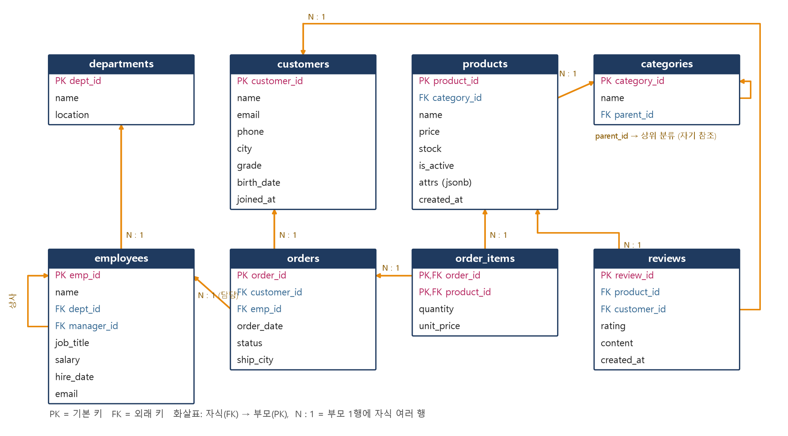

# PostgreSQL 데이터베이스 - 기초부터 심화까지

SQL 을 처음 배우는 사람을 위한 PostgreSQL 강의 자료입니다. 첫 쿼리부터 JOIN, 윈도우 함수, 인덱스 튜닝, 트랜잭션과 동시성, PL/pgSQL, JSONB, 권한·보안, 운영, Python 연동까지 다룹니다.

- **강사**: 김대철
- **교재(PDF)**: [`docs/PostgreSQL_학습교안.pdf`](docs/PostgreSQL_학습교안.pdf)
- **실습 환경**: Docker(PostgreSQL 18) + **DBeaver Community**, Python 3.10+ (19장)

교재에 실린 모든 실행 결과는 이 저장소의 예제를 PostgreSQL 18 에서 실제로 실행해 넣은 것입니다.

## 빠른 시작

1. [Docker Desktop](https://www.docker.com/products/docker-desktop/) 과 [DBeaver Community](https://dbeaver.io/download/) 를 설치합니다.
2. 저장소를 받고 실습 서버를 시작합니다.

```bash
git clone https://github.com/sinaboro/postgresql-tutorial.git
cd postgresql-tutorial
docker compose up -d
docker compose ps        # STATUS 가 healthy 이면 준비 완료
```

처음 시작할 때 `setup/01_schema.sql`, `setup/02_seed.sql` 이 자동으로 실행되어 실습 DB `shop` 이 만들어집니다.

3. DBeaver 에서 PostgreSQL 연결을 만듭니다.

| 항목 | 값 |
|---|---|
| Host / Port | `localhost` / `5432` |
| Database | `shop` |
| Username / Password | `postgres` / `postgres` |

4. `examples/` 의 예제 파일을 열고(`File → Open File`), `-- @ex` 로 나뉜 예제 블록을 선택해 `Alt+X` 로 실행합니다.

| 명령 | 하는 일 |
|---|---|
| `docker compose stop` | 서버 중지 (데이터 유지) |
| `docker compose down -v` → `docker compose up -d` | 실습 DB 를 처음 상태로 초기화 |
| `docker exec -it pg-shop psql -U postgres -d shop` | 컨테이너 안의 psql 로 접속 |

PC 에 PostgreSQL 이 이미 설치되어 5432 포트를 쓰고 있다면 `docker-compose.yml` 의 `"5432:5432"` 를 `"5433:5432"` 로 바꾸고 DBeaver 에서 5433 으로 접속합니다.

## 실습 데이터베이스 `shop`

가상 쇼핑몰입니다. 고객이 상품을 주문하고, 직원이 주문을 담당하고, 고객이 리뷰를 남깁니다.



| 테이블 | 행 수 | 설명 |
|---|---|---|
| departments | 5 | 부서 |
| employees | 15 | 직원 (manager_id 자기 참조) |
| customers | 20 | 고객 (주문 없는 고객 2명) |
| categories | 11 | 상품 분류 (3단계 트리) |
| products | 20 | 상품 (attrs JSONB) |
| orders | 120 | 주문 (2025-01 ~ 2026-06) |
| order_items | 237 | 주문 상세 |
| reviews | 62 | 상품 리뷰 |

## 커리큘럼

| 장 | 주제 | 예제 | 수준 |
|---|---|---|---|
| 01 | PostgreSQL 시작하기 - Docker, DBeaver, 첫 쿼리 | [01_intro.sql](examples/01_intro.sql) | 기초 |
| 02 | 테이블 만들기 - 자료형과 제약 조건 | [02_ddl.sql](examples/02_ddl.sql) | 기초 |
| 03 | 데이터 다루기 - INSERT / UPDATE / DELETE / UPSERT / MERGE | [03_dml.sql](examples/03_dml.sql) | 기초 |
| 04 | SELECT 기초 - WHERE, NULL, 정렬, 페이지 | [04_select_basic.sql](examples/04_select_basic.sql) | 기초 |
| 05 | 내장 함수 - 문자열, 숫자, 날짜, CASE | [05_functions.sql](examples/05_functions.sql) | 기초 |
| 06 | 집계와 그룹화 - GROUP BY, HAVING, ROLLUP | [06_aggregate.sql](examples/06_aggregate.sql) | 기초 |
| 07 | JOIN - INNER, OUTER, SELF, CROSS | [07_join.sql](examples/07_join.sql) | 중급 |
| 08 | 서브쿼리 - EXISTS, 상관 서브쿼리, LATERAL | [08_subquery.sql](examples/08_subquery.sql) | 중급 |
| 09 | 집합 연산과 CTE - 재귀 쿼리 | [09_set_cte.sql](examples/09_set_cte.sql) | 중급 |
| 10 | 윈도우 함수 - 순위, 누적, LAG/LEAD | [10_window.sql](examples/10_window.sql) | 중급 |
| 11 | 데이터 모델링과 정규화 | [11_modeling.sql](examples/11_modeling.sql) | 중급 |
| 12 | 뷰, 머티리얼라이즈드 뷰, 시퀀스, 스키마 | [12_view_sequence_schema.sql](examples/12_view_sequence_schema.sql) | 중급 |
| 13 | 인덱스와 실행 계획 (EXPLAIN) | [13_index_explain.sql](examples/13_index_explain.sql) | 심화 |
| 14 | 트랜잭션과 동시성 - MVCC, 격리 수준, 잠금 | [14_transaction.sql](examples/14_transaction.sql) | 심화 |
| 15 | 함수, 프로시저, 트리거 - PL/pgSQL | [15_plpgsql.sql](examples/15_plpgsql.sql) | 심화 |
| 16 | JSONB, 배열, 전문 검색, pg_trgm | [16_jsonb_array_fts.sql](examples/16_jsonb_array_fts.sql) | 심화 |
| 17 | 사용자와 권한 - GRANT, 행 수준 보안(RLS) | [17_security.sql](examples/17_security.sql) | 심화 |
| 18 | 운영 기초 - 모니터링, VACUUM, 백업과 복구 | [18_admin.sql](examples/18_admin.sql) | 심화 |
| 19 | Python 으로 PostgreSQL 다루기 (psycopg 3, pandas) | [python/](python/) | 심화 |
| 20 | 종합 프로젝트 - 쇼핑몰 매출 분석 리포트 | [20_project.sql](examples/20_project.sql) | 종합 |

예제는 psql 메타 명령(`\d` 등)을 쓰지 않아 DBeaver 에서 그대로 실행됩니다(18장 `\copy` 예제만 psql 전용).

## 폴더 구조

```
docker-compose.yml  PostgreSQL 18 실습 서버
setup/              실습 DB 스키마와 샘플 데이터 (서버 첫 시작 때 자동 실행)
examples/           장별 예제 SQL
exercises/          실습 문제지 (51문제)
solutions/          실습 문제 정답
python/             19장 Python 예제 (requirements.txt 포함)
work/               Docker 컨테이너와 파일(백업, CSV)을 주고받는 폴더
docs/               교재 PDF 와 원고(docs/guide/*.md)
tools/              샘플 데이터 생성기, 예제 검증기, 교재 빌더
```

## Python 예제 실행

```bash
cd python
python -m venv .venv
.venv\Scripts\activate            # macOS/Linux: source .venv/bin/activate
pip install -r requirements.txt
python 01_connect.py              # 기본 접속: postgres:postgres@localhost:5432/shop
```

다른 서버에 접속하려면 `DATABASE_URL` 환경변수를 지정합니다.

## 교재 다시 만들기 (관리용)

```bash
# 접속 정보: PGHOST, PGPORT, PGUSER, PGPASSWORD 환경변수 / psql 경로: PSQL 환경변수
python tools/verify.py            # 모든 예제와 정답을 새 DB 에서 실행해 예상하지 못한 오류가 없는지 검사
python tools/make_exercises.py    # 정답 파일에서 문제지 생성
python tools/build_guide.py       # 교재 PDF 생성 (reportlab, matplotlib, psycopg, pandas 필요)
```

교재 빌드에는 맑은 고딕(Windows 기본)과 [D2Coding](https://github.com/naver/d2codingfont) 글꼴이 필요합니다. D2Coding 폴더 위치는 `D2CODING_DIR` 환경변수로 지정합니다.
